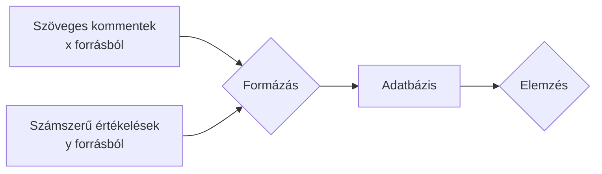
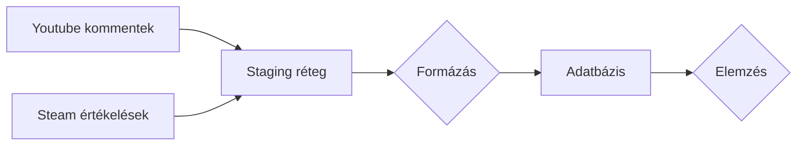

<!-- 5xl -->
# Játékos-visszajelzések adattárháza

Szerző: Gombos Ádám  
Neptun:  RQP5JZ   
Témavezető:  Lénárt Anett  
Projektazonosító:  2026-LA-03

---
## Probléma

A videojátékokról írt vélemények különböző formákban jelennek meg, például Youtube kommentek, vagy Steam értékelések.

***

A cél egy elemzésre alkalmas egységes adatbázis.

---
## Célfelhasználók

### Adatelemzők
- Milyen tényezők különböztetik meg a véleményeket?
### Videojáték iránt érdeklődők
- Minél pontosabb vélemény az adott játékról vásárlás előtt.
### Videojáték fejlesztők
- Felfedezni a népszerűbb feature-öket.

---
## Tervezett hatókör

### Tartalmazza:
- Elemzett játékok: Cyberpunk 2077, GTA V, Counter-Strike 2
- Adatgyűjtés Steam-ről és Youtube-ról
- Szöveg és metaadatok kezelése
- Egységesítés
- Adatbetöltés időpont nyugtázása
- Lekérdezések és optimalizálásuk
***
### Nem tartalmazza
- Több forrás bevonása
- Webes felület
- Interaktív adattábla
---
## Munkafolyamat

- Adatgyűjtés
    1. Adatlekérdezési script futtatása
    2. Adatbetöltés staging rétegbe
    3. SQL tisztítás, betöltés
- Adatelemzés
    1. Elemzési igény terve
    2. Lekérdezési SQL megírása
    3. Lekérdezés optimalizálás

***

---
## Következő lépések

- Dimenziótáblák pontos technikai tervezése
- Használt API-ok felmérése
- Szöveges elemzések módjának tervezése
- Elemző SQL-ek tervezése
